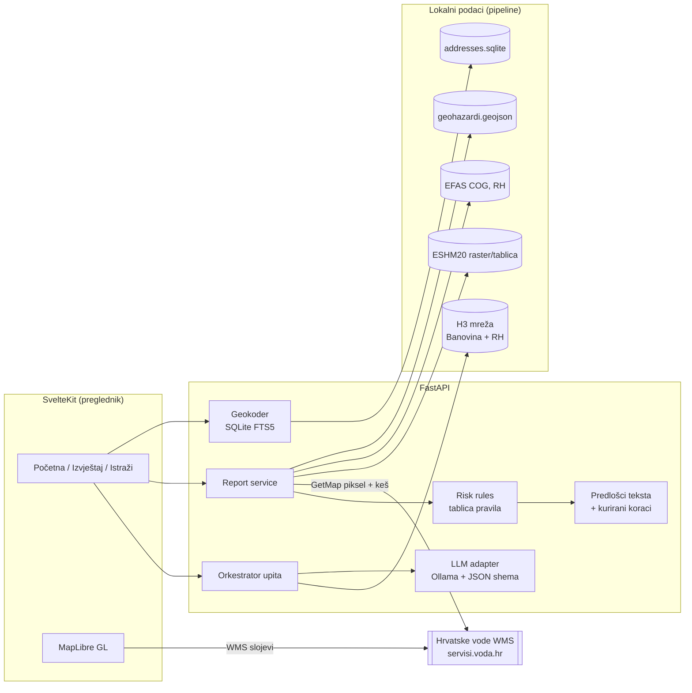

# ARCHITECTURE — Geo-rizik

Verzija 0.1 (30. 10. 2026.), čeka odobrenje.

## 1. Komponente

## 2. Tok podataka

**Pipeline (jednokratno, `pipeline/`, Python):**
1. DGU Adrese INSPIRE (GML, ETRS89/LAEA) → normalizacija → `data/addresses.sqlite` (FTS5 + WGS84 koordinate; ~1,68 mil. adresa, ~169 MB) → `GET /api/addresses?q=`.
2. MPGI geohazardi (WFS, gis2/gis3/gis4 s rezervnim hostovima) → GeoJSON po sloju u WGS84.
3. EFAS GeoTIFF-ovi → izrezani na RH → Cloud-Optimized GeoTIFF.
4. ESHM20 → PGA475 za RH (format ovisi o dostupnosti; vidi rizike).
5. H3 mreža (rezolucija 9, ~0,1 km²): Banovina sa svim slojevima (HV uzorkovan po pločicama s ograničenjem brzine), RH samo EFAS + ESHM20 (manja rezolucija).

**Izvještaj (zahtjev):** `GET /api/report?lat&lon` → geohazardi (point-in-polygon, STRtree) + EFAS/ESHM (čitanje piksela iz rastera) + HV (3 GetMap zahtjeva paralelno, keš po zaokruženoj koordinati) → tablica pravila → JSON s razinama i izvorima → predložak teksta.

**Istraži (SHOULD):** `POST /api/query {text}` → LLM vraća JSON po shemi → orkestrator provjerava katalog slojeva i pokrivenost → filtrira H3 → GeoJSON ćelija + popis nepodržanih dijelova.

## 3. Tehnološki izbor

| Sloj | Izbor | Razlog |
|---|---|---|
| Frontend | SvelteKit, MapLibre GL, Tailwind | Poznat stack, otvoreni kod, vektorske karte |
| Backend | FastAPI, rasterio, shapely 2, pyproj, h3, httpx | Prostorni rad u Pythonu bez baze |
| Podaci | SQLite (FTS5), GeoJSON, COG | Bez PostGIS-a; sve stane na jedan poslužitelj |
| LLM | Ollama + otvoreni model (odabir testom), JSON shema | Open-source; ograničen izlaz |
| Deploy | Docker Compose na VPS-u (≥ 8 GB RAM) | Jedan stroj, jednostavno |

## 4. Interoperabilnost

- **Konzumira** OGC/INSPIRE servise: WFS 2.0 (MPGI geohazardi, DGU katastar), WMS 1.3.0 (Hrvatske vode), INSPIRE ATOM (DGU adrese, visine). Koordinatni sustavi: HTRS96/TM (EPSG:3765), ETRS89/LAEA (EPSG:3035), WGS84; pretvorba preko `pyproj`.
- **Izlaže** REST API s OpenAPI opisom i GeoJSON odgovorima (COULD: OGC API – Features za H3 rezultate), pa ga općine ili drugi servisi mogu ugraditi.
- Katalog slojeva (`layers.yaml`) je strojno čitljiv opis izvora: izdavač, licenca, pokrivenost, rezolucija, datum. Iz njega se generiraju stranica "Izvori podataka" i provjera upita.

## 5. Preduvjeti

- **Tehnički:** dostupnost servisa Hrvatskih voda i MPGI-ja (gis1 trenutno vraća 502, pa koristimo više hostova); HV stil i legenda moraju ostati isti (test na poznatim točkama to hvata); VPS s ≥ 8 GB RAM-a za LLM.
- **Organizacijski:** pristojno uzorkovanje HV WMS-a (ograničenje brzine, noću); po potrebi upit Hrvatskim vodama za vektorske podatke.
- **Pravni:** Otvorena dozvola (DGU, MPGI): navođenje izvora. EFAS je pod ODbL: navođenje izvora i share-alike za izvedenu bazu. ESHM20 je pod CC BY 4.0: obavezno citiranje. Za Hrvatske vode u Capabilities piše bez ograničenja, ali na Portalu nema skupa, pa to navodimo kao ograničenje. Disclaimer: nije stručno mišljenje. Bez osobnih podataka.

## 6. Glavni rizici

| Rizik | Vjerojatnost | Ublažavanje |
|---|---|---|
| ESHM20 nema jednostavan pristup po točki | srednja | do 1. 11. odluka; rezerva: unaprijed izračunata mreža iz GitLab podataka ili izbacivanje potresa u COULD |
| HV WMS pada ili mijenja stil | niska | keš, test boja legende, poruka "privremeno nedostupno" |
| Otvoreni LLM slab na hrvatskom | srednja | test na ~20 upita; ručni filteri uvijek rade |
| Uzorkovanje HV za H3 traje predugo | srednja | samo Banovina, pokrenuti 3. 11. preko noći |
